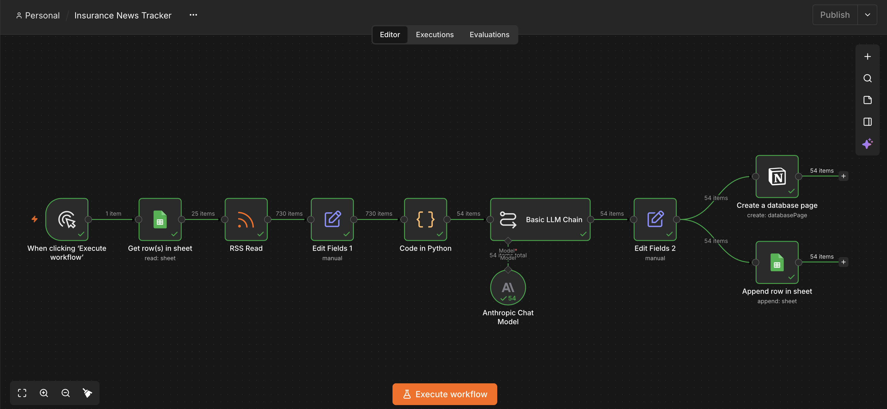
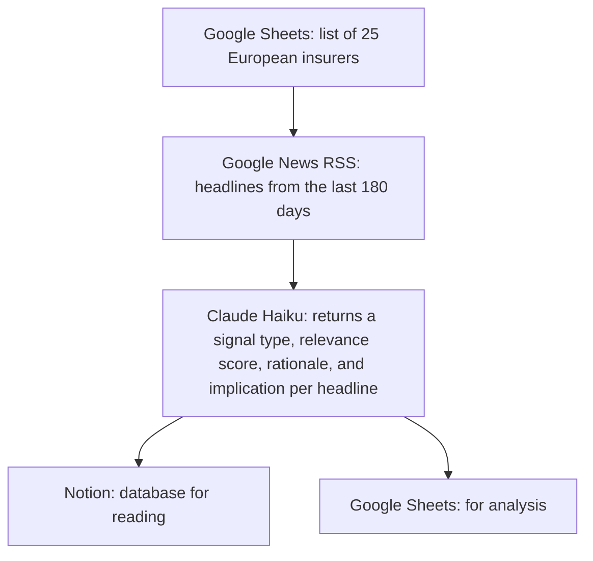
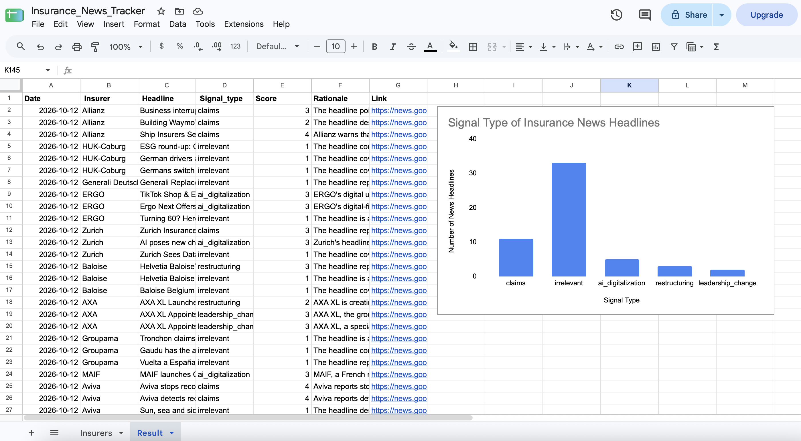

# Insurance News Tracker

This workflow, built with n8n, Google Sheets, Notion, and an Anthropic Chat Model
(Claude Haiku 5.5), tracks news on 25 European insurers and scores it for relevance 
to claims processing automation. The public Notion database is available [here.](https://app.notion.com/p/3f783b9b58f280fbb877ee1dde6a9ccc?v=3f783b9b58f2806891b6000ce6e42a25&source=copy_link)

### n8n Flow

### Results (based on one run)
- 54 headlines were found across the 25 insurers searched
- 33 (61%) were classified as irrelevant, so most news about these insurers has nothing to 
do with claims or AI
- Headlines related to claims were assigned the highest scores

### Limitations
- The signal type, score, and rationale are rough estimates as they are only based on the
news headlines, not article texts
- The scores are assigned by the AI model but not validated further
- Only news headlines in English are searched, so German-language and other local coverage might be missed

### Setup
- Import `workflow.json` into n8n and connect using your own Google Sheets, Notion, 
and Anthropic credentials
